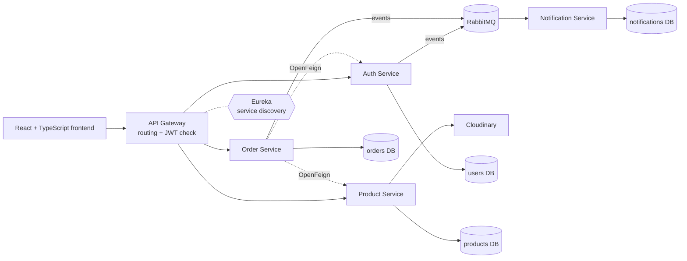

# SwiftShop | E-commerce Microservices

SwiftShop is an e-commerce web application built with a **microservices architecture**: Spring Boot services behind a Spring Cloud API Gateway, with Eureka service discovery, OpenFeign for service-to-service calls, RabbitMQ for asynchronous notifications, and a React + TypeScript storefront.

> **Academic team project.** SwiftShop was built in 2024 by a team of INSAT software engineering students as part of the *Personal and Professional Project (PPP)* course. It is a learning project, not a production system.

This repository is the project's landing page. The code lives in two repositories:

| Repository | Content |
|---|---|
| [PPP_E-commerce_microservices_Backend](https://github.com/SAHNOUN-HOUSSEM/PPP_E-commerce_microservices_Backend) | Spring Boot microservices, with a [detailed README](https://github.com/SAHNOUN-HOUSSEM/PPP_E-commerce_microservices_Backend/blob/main/README.md) covering architecture, endpoints and local setup |
| [PPP_E-commerce_microservices_Frontend](https://github.com/SAHNOUN-HOUSSEM/PPP_E-commerce_microservices_Frontend) | React + TypeScript storefront and admin dashboard |

## Key features

- **Accounts and authentication**: registration and login, BCrypt-hashed passwords, JWT tokens checked by the API gateway.
- **Catalog**: products, brands and categories with pagination, sorting and category search; product images stored on Cloudinary.
- **Cart and orders**: a cart kept in the browser, order placement with a stock check, and order history (own orders for users, all orders for admins). There is no online payment.
- **Notifications**: registration and order events sent through RabbitMQ and stored by a notification service.
- **Admin dashboard**: catalog and user screens shown to `ADMIN` accounts in the frontend.

## Technology stack

| Area | Technologies |
|---|---|
| Backend | Java 17, Spring Boot 2.5, Spring Cloud 2020.0 |
| Edge and discovery | Spring Cloud Gateway, Netflix Eureka |
| Service communication | Spring Cloud OpenFeign (synchronous), RabbitMQ (asynchronous) |
| Data | PostgreSQL, one database per service (Spring Data JPA / Hibernate) |
| Security | Spring Security, JWT (HS256), BCrypt |
| Tracing | Spring Cloud Sleuth and Zipkin (configured; end-to-end tracing not verified) |
| Media | Cloudinary |
| Frontend | React 18, TypeScript, Vite, Tailwind CSS, React Router, Axios |
| Local infrastructure | Docker Compose for supporting services (PostgreSQL, pgAdmin, RabbitMQ, Zipkin) |

## Architecture

- **Eureka** is the service registry. All services register with it, and the gateway and OpenFeign clients look services up by name through it. This lets the gateway route to services by name, using client-side load balancing.
- **OpenFeign** carries the synchronous calls. The order service validates the caller's token and loads the user through the auth service, and checks and updates stock through the product service.
- **RabbitMQ** carries asynchronous events. The auth and order services publish them; the notification service consumes them.
- **Database per service**: each service owns its PostgreSQL database and never reads another service's tables.

## Microservices and responsibilities

| Service | Responsibility |
|---|---|
| Eureka Server | Service registry; the other services register and resolve each other by name |
| API Gateway | Single entry point: routes requests to the services through Eureka, validates JWT signatures locally on protected routes, configures CORS |
| Auth Service | Registration, login and JWT issuing; user profiles and roles (`USER`, `ADMIN`); publishes a registration event |
| Product Service | Products, brands and categories, image upload to Cloudinary, stock checks and stock updates for orders |
| Order Service | Order placement and history; checks stock before saving an order and asks the product service to decrement stock afterwards (separate steps, not a distributed transaction); publishes an order event |
| Notification Service | Consumes RabbitMQ events and stores them; attempts a registration confirmation email |

User management lives in the Auth Service. The backend repository also contains an empty legacy `user-service` module.

## Frontend

The storefront is a **React 18 + TypeScript** single-page application built with **Vite** and styled with **Tailwind CSS**. It provides:
- catalog browsing by category, with search, sorting and paging, and product detail pages;
- registration and login;
- a cart kept in the browser's local storage;
- order placement and order history;
- an admin dashboard for products, brands, categories, users and orders.

Some pages are placeholders or not connected to the backend: the wishlist, the standalone cart page and the profile settings form.

## Getting started

Detailed configuration and setup steps are in the [backend README](https://github.com/SAHNOUN-HOUSSEM/PPP_E-commerce_microservices_Backend/blob/main/README.md#running-locally). In short, you need:

- **JDK 17** and **Maven**. The build fails on JDK 21 because of the project's Lombok version.
- **Docker Compose** for the supporting infrastructure (PostgreSQL, pgAdmin, RabbitMQ, Zipkin). The four service databases are created by hand.
- Your own **Cloudinary** credentials, kept outside the repository.
- **Node.js** for the frontend (`npm install`, then `npm run dev`).

The backend's parent `pom.xml` still lists a missing `sse-service` module, so the published source needs a temporary local workaround (described in the backend README) before it builds.

**What has been verified.** The backend builds on JDK 17 with that workaround, and the Eureka server starts. Running the other services, the Docker Compose infrastructure and the full application end to end has not been verified.

## Known limitations

> **Security:** SwiftShop is an academic project and has not undergone production security hardening. Authentication, authorization, sensitive-data handling and input validation have known limitations. It should not be deployed to an untrusted network or used with real user data without further review and remediation.

- **No automated tests** in the backend.
- **No containerized services or orchestration.** Docker Compose runs only the supporting infrastructure, the services have no Dockerfiles, and there are no Kubernetes manifests.
- **Build workaround needed** for the missing `sse-service` module (see *Getting started*).
- **No distributed transaction for orders.** Saving an order, updating stock and publishing the event are separate steps, so a failure in between can leave data inconsistent.
- **Registration emails** are not expected to work as currently written.
- **Hard-coded API address.** The frontend calls the gateway at `http://localhost:8083`.

## Team

Academic team project by INSAT software engineering students. Contributors, from the GitHub repositories:

- [SAHNOUN-HOUSSEM](https://github.com/SAHNOUN-HOUSSEM)
- [FkihMehdi](https://github.com/FkihMehdi)
- [mehdi-khelil](https://github.com/mehdi-khelil)
